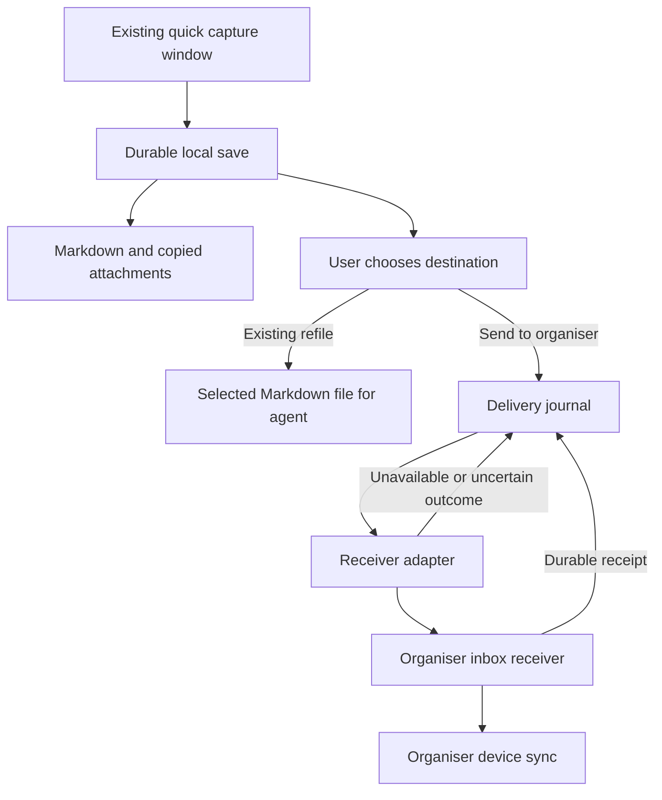

# Quick Capture integration handover

Version 1.1 · 15 October 2026 · Implementation brief for the agent working in the existing Quick Capture repository

## Objective

Integrate the existing macOS menu-bar capture app with a forthcoming personal organiser. Preserve its fast global-shortcut workflow. A capture must be safely saved locally without requiring the organiser to be running or a network connection. Delivery to the organiser happens asynchronously and must tolerate crashes, retries and lost acknowledgements without losing or duplicating captures.

Start with repository inspection, then implement the capture-side foundation and a test receiver. The organiser and backend may not exist yet. Do not claim end-to-end production integration until a real receiver is connected and tested.

## Confirmed product context

The user owns the capture app. It lives in the Mac menu bar and opens quickly through a keyboard shortcut. Both work and home laptops are Macs, and the user can install apps. An iPhone client and a Go terminal interface are planned for the wider system. Apple developer membership is planned, but is not a prerequisite for local development.

The organiser combines notes, projects, tasks, documents, bookmarks and a large calendar. Relevant areas are work, personal administration, health, a keyboard business, learning and interests. Captures include bills, return deadlines, appointments, accounts documents, shopping items, Twitter/X links, playlists and courses in design, robotics and electronics.

The user's main problems are excessive upkeep, juggling applications and moving between devices. A capture must not require a category, project, priority, due date or account connection. Preserve existing shortcuts and interaction behaviour unless an actual defect requires a change.

Notes must remain Markdown, attachments ordinary files, and the wider calendar must support open interchange such as ICS. Calendar sync and ICS interchange are separate requirements. This integration creates inbox items; it does not implement calendars or interpret every saved item as a task.

## Storage decision and relationship to the earlier plan

The organiser database is the source of truth for accepted shared records. Note bodies are Markdown text; projects, tasks, reminders and relationships are structured records. Attachments remain ordinary files. Portable export includes Markdown, attachments, ICS and documented metadata. This resolves the previous storage mismatch; a live Markdown folder does not need to be authoritative for the organiser.

Quick Capture continues using its own plain Markdown files and minimal built-in Markdown editor. Do not migrate its source notes into the organiser database or replace its editor. The user likes Obsidian and other Markdown editors; Emacs itself will not be used. The Emacs-inspired refile behaviour already implemented in Quick Capture must be preserved. External editing of organiser notes is a separate organiser feature, outside this integration.

The companion document is `markdown-library-implementation-plan.md`, version 1.0, dated 15 October 2026. Its database-owned content model now aligns with the storage decision. Retain its durable-save, idempotency and offline-work principles. Its flat-library product scope is still narrower than the personal organiser now envisioned. Do not assume its document API already supports inbox captures, and never write directly into another app's database.

## Existing refile workflow and the new handoff

Quick Capture can take a todo and append it to a Markdown file anywhere on the computer. The user refiles tasks into an `inbox.md` in a directory where a coding agent is working; that agent reads the file and acts on those tasks. This is an established workflow, not a proposed feature.

| Action | Ownership and behaviour |
|---|---|
| Refile to file | Preserve the existing append-to-selected-file behaviour and destination selection. The target remains an ordinary independently managed Markdown file. |
| Send to organiser | New explicit action that snapshots selected content into a durable queue and delivers it to the organiser inbox. |
| Edit in Quick Capture | Continue editing local Markdown with the existing editor. Changes do not silently update an already queued or delivered snapshot. |

Example: “Fix the dropdown focus bug” can be refiled into a repository's `inbox.md`. “Return headphones” can be sent to the organiser. Neither destination requires the other. Do not automatically send repository tasks or historical captures to the organiser, and do not redirect existing refile actions into the new transport. Sending to both destinations requires an explicit user action for each.

Both handoffs are one-way in this milestone. An agent checking off a repository task does not update the organiser; an organiser edit does not rewrite the source capture. Do not watch, import, rename, index or claim ownership of arbitrary refile destinations. Preserve the existing source removal/retention behaviour of refile after inspecting it; do not invent new destructive semantics.

Keep existing append behaviour intact and add regression coverage. If inspecting it reveals unsafe replacement of the target file, preserve unrelated bytes and handle concurrent changes before writing. Arbitrary agent-edited files have no receipt protocol: do not route file appends through the organiser retry queue or promise exactly-once append after a crash. Report an uncertain append outcome rather than blindly appending again.

## Inspect the existing repository first

Read repository instructions and identify the language, UI framework, shortcut registration, persistence layer, current export destinations, attachment handling, sandbox settings, signing configuration and tests. Determine how drafts survive window dismissal and app termination. Record the measured shortcut-to-input latency before changing the capture path.

Produce a short integration decision record naming the existing components to reuse and the smallest changes required. Keep the current app's architecture and storage where they already meet these requirements; avoid a rewrite. Existing captures and destinations must remain recoverable. Do not bulk forward historical captures by default.

The plain Markdown save format is confirmed. Inspect its file layout, todo representation and refile source-retention semantics, whether attachments already work, the app's sandbox permissions and whether any receiver exists. These are inspection tasks, not reasons to ask the user to describe the codebase.

## Scope

Preserve existing local capture persistence and add a separate organiser handoff snapshot, a durable delivery queue, a versioned contract, retry handling, minimal integration settings, honest delivery status and a receiver fixture. Support text and URLs first. If file capture exists, integrate it; otherwise add basic file import as a separate step after text reliability is proven.

Do not build the full organiser, iPhone app, TUI, general sync engine, Twitter bookmark scraper, calendar integrations, OCR, AI classification or a new authentication system. Do not replace the menu-bar interface with a project-management form.

## Ownership and delivery flow



Quick Capture owns its drafts, saved source captures and pending organiser delivery snapshots. Refile destinations remain independently managed files. The receiver owns accepted inbox items and their subsequent organisation. After acceptance, edits, moves and deletion in the organiser must not be undone by a retried create operation. Quick Capture is initially an append-only producer, not another editor of the organiser's documents.

Distinguish three states in the UI: saved locally, delivered to organiser, and available on other devices. A local receiver acknowledgement proves only the second. Do not display cross-device sync success unless the organiser explicitly reports it.

## Proposed local persistence design

Keep the current Markdown source-file layout. For an explicitly requested organiser handoff, store a separate immutable delivery snapshot bundle with `content.md`, optional ordinary attachment files, and a small manifest. Store queue state in the app's existing transactional store if suitable. JSON metadata and a delivery database are permitted; note content must not exist only inside an opaque database.

Generate the handoff capture ID when the user chooses Send to organiser. Stage a snapshot of the selected Markdown and copied attachments in private app storage, flush and atomically publish the complete bundle on the same filesystem, then commit its queue entry. “Queued for organiser” succeeds only after durable bundle publication and durable queue registration. “Saved locally” refers to the existing source-file save and does not depend on queue creation. If queueing fails, retain the source and report the handoff failure without falsely implying the local save failed. A crash between these steps must be repairable by scanning complete manifests for missing queue entries. Ignore incomplete staging bundles during delivery and offer recovery for recoverable drafts. Never erase staging data blindly on startup.

The local file and database writes are not one transaction: explicitly test each interruption boundary. Document the durability guarantees supported by the actual filesystem APIs used.

Copy attachment bytes before relying on them. A reference to Downloads or a temporary drag-and-drop URL is insufficient. For large files show a local importing state; do not report the whole capture as saved while a required copy is incomplete. Perform copying and hashing away from the UI thread.

Preserve Markdown source exactly. Do not inject task syntax, reformat the body or resolve relative dates silently. Optional metadata can live in the manifest or documented YAML front matter; do not rewrite unknown front-matter fields. Use relative attachment links where needed and safe generated filenames. Original filenames belong in metadata, not unchecked paths.

## Version one contract proposal

This is a proposed interface to agree with the organiser agent, not an existing API. Represent it in JSON Schema and deterministic fixtures in the repository. Keep the domain envelope independent of HTTP, IPC or files.

| Field | Meaning |
|---|---|
| `schema_version` | Integer `1`; reject unsupported major versions without dropping the capture |
| `capture_id` | UUID for this explicit handoff snapshot; stable across retries and restarts, not derived from a filename |
| `created_at` | UTC timestamp with offset; descriptive, never the deduplication key |
| `source` | App name/version and installation ID; installation ID is not a credential |
| `title` | Optional user-supplied title; empty is allowed |
| `body_markdown` | Original text, including Unicode and line breaks |
| `source_url` | Optional user-supplied URL; preserve rather than fetch automatically |
| `kind_hint` | Optional `note`, `task`, `link` or `document`; no hint means generic inbox item |
| `attachments` | Stable attachment IDs, safe relative paths, original names, media types, byte counts and SHA-256 digests |

Require some content: text, a URL or an attachment. The transport wrapper adds `workspace_id`, `operation_id` and `payload_sha256`. Bind a capture to the selected destination before its first send; never reroute pending captures to a newly selected account. Hash a specified canonical UTF-8 serialization and attachment digests, not arbitrary serializer output. Freeze the full wrapper before transmission. Credentials are excluded from it.

Example content envelope:

```json
{
  "schema_version": 1,
  "capture_id": "123e4567-e89b-42d3-a456-426614174000",
  "created_at": "2026-10-15T17:30:00Z",
  "source": {"app": "Quick Capture", "version": "development", "installation_id": "example-installation"},
  "title": null,
  "body_markdown": "Return headphones by Friday. Check the receipt for the deadline.",
  "source_url": null,
  "kind_hint": null,
  "attachments": []
}
```

Store “Friday” as written. Date parsing and reminders are future optional organiser behaviour requiring visible confirmation of ambiguous dates.

The receiver returns a receipt containing contract version, operation ID, capture ID, organiser item ID, payload digest and acceptance time. It may provide an allowlisted open-item link. Acceptance means the inbox item, attachment bytes or verified durable references, and deduplication record are committed and recoverable. A response saying only “queued in memory” is not sufficient.

Deduplicate within the workspace by capture ID and persist operation results. Repeating the same ID and digest returns the same receipt. The same ID with different content is an explicit conflict. Retain deduplication information after an item is moved or deleted so retries cannot recreate it. The contract uses at-least-once delivery with idempotent acceptance; do not promise exactly-once network transmission.

## Transport selection

Implement a `CaptureDestination` abstraction with capability discovery and `deliver(frozenCapture)` returning a durable receipt or a typed error. Include a fake implementation for tests. Pick one real adapter after repository inspection; do not implement several competing transports.

Preferred first integration, if no receiver exists: a user-configured local spool folder with immutable capture bundles and durable receipt files. Publish bundles atomically. The receiver imports idempotently and writes a receipt atomically only after its transaction commits. A receiver restart after import but before receipt creation must return the original receipt on retry. Poll in addition to filesystem notifications so a missed notification cannot strand work. Treat the folder as a local handoff, not as a cross-device sync mechanism.

If an established organiser API or local IPC service already exists, use its supported protocol instead. For HTTP, a proposed `POST /v1/inbox/captures` is a new endpoint needing explicit implementation, not an endpoint from the old plan. Network connections require TLS and scoped authentication; local listeners must not be unauthenticated or exposed to the LAN. Evaluate sandbox and process-identity constraints before selecting IPC.

A custom URL may open an item or wake the organiser, but must not carry note bodies, credentials or attachments and must not be the durable delivery mechanism. Do not share a writable SQLite file between the applications. Do not assume App Groups or future signing entitlements are available.

## Queue behaviour

States: `pending`, `delivering`, `delivered`, `retry_wait`, `needs_attention`. Persist the frozen request before sending. On restart, retry uncertain deliveries with the exact same IDs and bytes. Serialize workers or use durable leases so multiple launch paths cannot mutate the same request concurrently.

Retry temporary unavailability and timeouts with capped exponential backoff and jitter. Honour explicit retry delays where available. Authentication errors require reconnecting; validation errors, version mismatches and payload conflicts need attention. Keep the capture in every case. A manual Retry action resumes eligible work without creating new IDs.

Freeze the delivery snapshot at queue creation. Keep the original local note editable in Quick Capture; never freeze its editor because delivery is pending. Source edits or refiles do not mutate or invalidate the snapshot. Retry and repeated activation of the same pending send reuse its IDs. Reopening a delivered send shows its receipt rather than creating a duplicate. An intentional “Send as new item” action creates a new snapshot and IDs; no update protocol is implemented here. Retain a small local mapping from a source item to its handoff receipts where the existing data model permits it; filenames alone are not stable identity.

Deleting local history must not silently remove undelivered content. Do not automatically delete delivered source captures in this milestone. Define a later retention policy before cleanup. Integration disablement pauses delivery while capture continues locally. Existing standalone save destinations remain available, with clear indication of which destination is active.

## User experience

Keep the shortcut, focus behaviour and capture-window appearance. No login, network handshake, preview fetch, indexing or attachment hashing may block opening the window. Keep ordinary capture and refile defaults unchanged. Add a separate “Send to organiser” action; only items sent through it default to the organiser inbox without classification. Connection and destination setup belong in preferences. Do not add a mandatory destination picker to every capture.

After saving, use unobtrusive feedback: “Saved locally”, “Waiting for organiser”, “Delivered”, or “Delivery needs attention”. Put queue detail and Retry in a small status view. Do not interrupt every capture because the organiser is offline. If saving fails, retain the draft, show the error and do not close the window as though it succeeded.

Measure shortcut-to-input latency before and after, plus save latency for representative text captures. Preserve the existing responsiveness; report measurements rather than inventing a performance claim. Network work must not add to the local save critical path.

## Security and compatibility boundaries

Captures may contain work, financial and medical information. Use private application storage, restrictive file permissions and the platform credential store. Log IDs and error codes rather than body text, filenames, tokens or attachment contents. Diagnostics should be redacted. Do not send capture content to AI services or analytics.

Validate schema version, lengths, attachment sizes and checksums. Reject absolute or escaping relative paths and symlink traversal when reading bundles; use bounded parsing. Do not execute captured content or automatically fetch URLs. Document supported input limits and preserve failed captures for recovery.

Do not start a second file-sync service over a future organiser vault. The organiser owns cross-device propagation. A spool-folder handoff is local to each Mac. iPhone capture will later use the organiser's own intake path and the same semantic contract where appropriate.

## Implementation sequence

1. Inspect and document the existing capture flow; establish a baseline and preserve current data.
2. Preserve the source Markdown model and editor; add the versioned handoff model, validation and separate snapshot bundle using existing components where possible.
3. Add the durable queue, frozen payload semantics and crash recovery.
4. Build the fake receiver and failure fixtures; implement one chosen adapter and a development receiver if the organiser is absent.
5. Add minimal settings, pending/error visibility and manual retry without expanding the capture form.
6. Run the reliability matrix below and document commands and evidence.
7. Deliver the contract, receiver obligations and compatibility decision record to the organiser agent. Connect and verify real device sync only when its receiver exists.

Do not migrate existing history destructively. If a migration is necessary, make it versioned, restart-safe and reversible with a verified backup. A historical import is a separate explicit action with stable import IDs.

## Acceptance tests

| Scenario | Required outcome |
|---|---|
| Organiser closed and network unavailable | Capture saves and remains readable as Markdown |
| App restart after local save | Capture and pending delivery survive |
| Crash between bundle publication and queue commit | Recovery recreates the queue entry without duplicate content |
| Receiver commits but acknowledgement is lost | Retry yields the original receipt and one inbox item |
| Same ID with changed content | Receiver rejects the mismatch and retains original data |
| Receiver moves or deletes a previously accepted item | Retry does not restore or recreate it |
| Attachment source moved after saving | Copied attachment remains available |
| Interrupted attachment copy | No false whole-capture success; draft/import is recoverable |
| Disk full or permission failure | No false saved status; draft remains visible/recoverable |
| Unicode, multiline Markdown and code blocks | Source text survives round trip unchanged |
| Traversal path, symlink escape or corrupt digest | Receiver refuses unsafe input without losing source capture |
| Authentication or schema error | Queue pauses with actionable status; capture remains accessible |
| Integration disabled or destination changed | Existing queued data stays bound to its original destination |
| Multiple simultaneous delivery triggers | One logical inbox item and consistent local state |
| Existing shortcut, Markdown editor and save workflow | Behaviour retained; measured latency shows no material regression |
| Refile todo to a repository inbox.md | Existing append behaviour retained; unrelated file content preserved; no organiser item created |
| Organiser unavailable during refile | Existing file handoff still works independently |
| Agent checks off a repository todo | No background rewrite or organiser status change |
| Edit or refile the source after sending | Frozen delivery content remains unchanged; source editor stays usable |
| Repeated activation or retry of the same send | Existing handoff identity reused; no duplicate organiser item |
| User explicitly sends an edited capture as new | New handoff identity and separate item, without altering the earlier delivery |
| Real organiser connected later | Capture from each Mac appears on the other Mac and iPhone through organiser sync |

The final row is a future end-to-end gate, not something a fake receiver can prove. Test the implemented durability boundaries with fault injection rather than relying only on happy-path UI tests.

## Required agent deliverables

Provide working capture-side changes, migration notes if needed, schema and example fixtures, the selected adapter, a test receiver where needed, focused reliability tests, and a short integration README. Include the receipt and error contracts, attachment rules, deduplication retention and setup instructions. Report actual build/test results and explicitly identify untested Apple signing or device scenarios.

Record the resolved storage decision and one-way handoff boundaries in an architecture decision note: Quick Capture owns Markdown source files, organiser owns accepted database records, and agent inbox files remain independent. Do not write into another app's internals. Production distribution, hosting and credentials can be resolved when needed; they should not block the local foundation.

## Starting instruction

Read this handover and the repository instructions. Inspect the current menu-bar app and preserve its fast capture workflow, Markdown editor and append-to-file refiling for coding agents. Implement the durable Markdown capture and delivery boundary, with an idempotent test receiver and failure tests. If the organiser is not yet implemented, complete the capture-side work and document the precise receiver contract. Ask the user only for a consequential preference or access decision that repository inspection cannot resolve.
